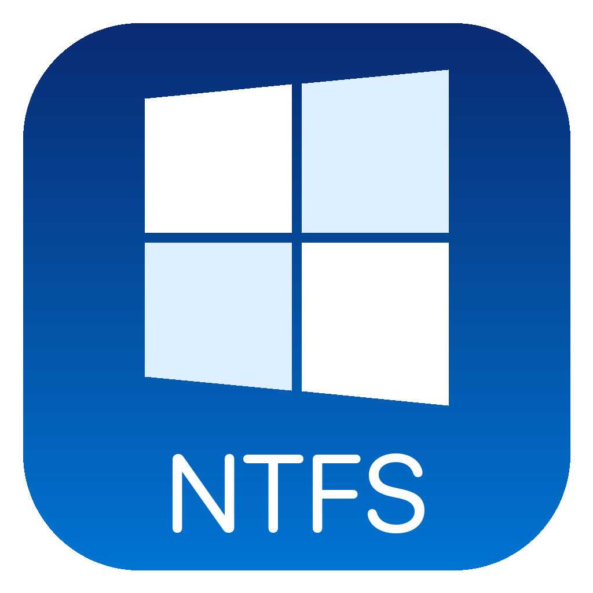

# NTFS Drive for Mac

A tiny, free macOS app to **mount NTFS drives with read/write access** and **eject them safely**, as an alternative to paid tools like Tuxera or Paragon.

It's a thin wrapper around [macFUSE](https://macfuse.github.io/) and [ntfs-3g](https://github.com/tuxera/ntfs-3g): one window shows the drive status, plus **Mount Read/Write** and **Eject** buttons.

<p align="center"></p>

> Tested on an Apple Silicon Mac with macOS 26 (Tahoe), macFUSE 5.5.0, and ntfs-3g-mac 2026.9.28.

## Features
- Detects every connected NTFS partition automatically
- Mounts them read/write through ntfs-3g (macFUSE kernel extension)
- Falls back to read-only if a mount fails, so the drive stays usable
- Ejects only disks that contain NTFS partitions
- Mounts survive closing the app (ntfs-3g runs in the background on its own)

## 1. Install dependencies
```bash
brew install --cask macfuse
brew tap gromgit/homebrew-fuse
brew install gromgit/fuse/ntfs-3g-mac
```

## 2. Allow the macFUSE kernel extension (Apple Silicon, one-time)
The macFUSE **FSKit** backend doesn't work for ntfs-3g block-device mounts (they need root, and the FSKit extension is enabled per user, so you get `File system extension not found`). Use the kernel extension instead:

1. Shut down. Hold the power button until **Loading startup options** appears, then choose **Options**.
2. **Utilities → Startup Security Utility →** your disk **→ Security Policy…**
3. Choose **Reduced Security** and tick **Allow user management of kernel extensions from identified developers**. Restart.
4. Try a mount once (step 4). Then go to **System Settings → Privacy & Security**, click **Allow** next to *Benjamin Fleischer* (macFUSE), and restart.

## 3. Build the app
```bash
git clone https://github.com/rishiagrawal1602/ntfs-drive-mac.git
cd ntfs-drive-mac
./build.sh            # installs to /Applications/NTFS Drive.app
# ./build.sh ./build  # or build somewhere else
```

## 4. Use it
Open **NTFS Drive**:
- **🔒 READ-ONLY:** click **Mount Read/Write** and enter your password.
- **✅ READ/WRITE:** click **Eject** before unplugging.

The first time you open it, right-click → **Open** (the app is ad-hoc signed).

The scripts also work without the app:
```bash
sudo scripts/mount-ntfs.sh
sudo scripts/eject-ntfs.sh
```

## Troubleshooting
| Message | Fix |
|---|---|
| `Operation not permitted` / "macOS blocked disk access" | System Settings → Privacy & Security → **Full Disk Access** → add **NTFS Drive** (or Terminal) |
| `unsafe state` / hibernated | Windows didn't shut down cleanly. In Windows, hold **Shift** while clicking Shut Down, or disable Fast Startup |
| `File system extension not found` | You're on the FSKit backend; follow step 2 to use the kernel extension |
| No **Allow** button in Privacy & Security | Try a mount first (that triggers the prompt), and make sure step 2 is done |

## Project layout
```
src/NTFSDrive.applescript   app UI (status window + buttons)
scripts/mount-ntfs.sh       finds NTFS partitions, mounts them read/write with ntfs-3g
scripts/eject-ntfs.sh       unmounts and ejects NTFS disks
icon/                       app icon (.icns), preview PNG, and the Python script that draws it
build.sh                    builds and signs "NTFS Drive.app"
```

## Disclaimer
Writing to NTFS from macOS through ntfs-3g is widely used but not officially supported by Apple or Microsoft. Back up important data. Always eject before unplugging.
The icon is an original design and isn't affiliated with Microsoft.

## License
MIT
